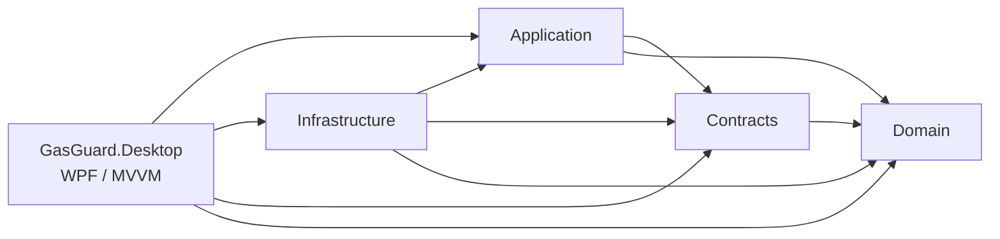
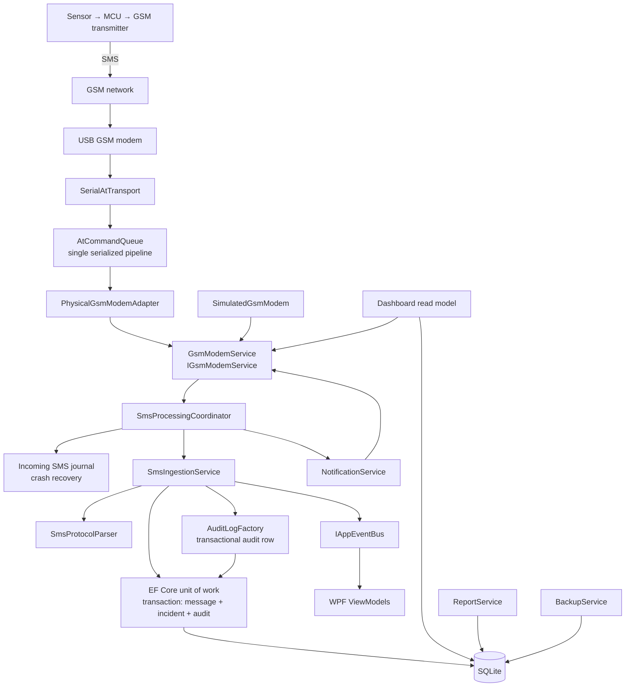

# GasGuard Desktop — Architecture

## Purpose and boundaries

GasGuard Desktop is a local Windows monitoring application for SMS-based gas-detector telemetry.
It validates incoming SMS, creates a durable incident record, exposes operator workflow and
reporting, and manages a USB GSM modem. Detector safety functions are outside this application.

The architecture deliberately separates:

- safety-relevant interpretation rules (Domain);
- SMS protocol contracts and modem models (Contracts);
- use cases and orchestration (Application);
- hardware, database, reporting and OS integration (Infrastructure);
- WPF presentation and application composition (Desktop).

## Project dependencies

| Project | Responsibility | Must not contain |
|---|---|---|
| `GasGuard.Domain` | Entities, enums, incident state transitions, device operational-state rules, domain exceptions | EF Core, serial ports, WPF |
| `GasGuard.Contracts` | Protocol v1 result models, field constants, modem status/results/events | Database or UI code |
| `GasGuard.Application` | Use cases, validation, parser, ingestion transaction orchestration, notification dispatch, coordinator, interfaces/DTOs | WPF controls, `SerialPort`, EF Core |
| `GasGuard.Infrastructure` | EF Core SQLite context/repositories/migrations, physical and simulated modems, AT queue, CSV reports, dashboard/read queries, backup/restore, audit persistence | Windows UI |
| `GasGuard.Desktop` | WPF views, ViewModels, dialogs, navigation, converters, file logging, DI composition | Business rules in code-behind |

Application and Domain have no dependency on WPF or a concrete serial implementation. The physical
modem is hidden behind `IGsmModemService` and the AT transport abstraction. The desktop resolves
these interfaces through dependency injection.

## Main runtime components

## SMS ingestion use case

`SmsIngestionService` is the central safety-rules path. Incoming messages originate from:

- `+CMT` unsolicited direct delivery;
- `+CMTI` notification followed by unread-message reconciliation;
- scheduled polling of unread stored SMS;
- explicit simulator injection.

The coordinator journals direct/queued messages before processing, passes them to
`ISmsIngestionService`, and deletes a stored modem SMS only after `IngestionResult.Persisted` is true.
A startup recovery task replays the journal. The full protocol/security rationale is in
[SMS_SECURITY_AND_PROTOCOL.md](SMS_SECURITY_AND_PROTOCOL.md).

Processing order:

1. Record receipt time in UTC; normalise the sender if possible.
2. Compute a SHA-256 fingerprint over sender + SMS body.
3. Skip an already-processed modem storage reference when one is supplied.
4. Open an EF Core transaction.
5. Parse with `SmsProtocolParser`; a parse failure stores the raw message with `Invalid`, never a
   reading or incident.
6. Look up the detector by code; unknown devices are stored and rejected.
7. Compare the sender number with the detector's expected sender; mismatches are rejected and
   recorded as a device communication error.
8. Apply the bounded duplicate/replay policy and sequence-reset rules.
9. For an accepted STATUS/NORMAL message, update the detector's last successful report.
10. For an accepted GAS_CRITICAL/GAS_WARNING message, create an `Incident` with a unique deduplication
    key and update the detector.
11. Add the audit entry in the same transaction as the message/incident.
12. Commit message + incident + communication log + audit atomically, then publish UI/notification
    events. The incoming SMS journal entry is removed only after the committed result.

The raw SMS `BodyRaw` is preserved exactly once even when parsing or authorization fails. A duplicate
SMS is retained as a separate `Duplicate` message when it is not an already-stored modem reference;
the original is always retained for review. A database failure rolls back both the message and
incident, and the physical modem keeps the message for later reconciliation.

### Deduplication and sequence resets

- SMS fingerprint: `SHA256(normalised-sender | trimmed-body)`, with duplicate suppression bounded to a
  15-minute window.
- Incident dedup key includes device, simulated/real mode, event and a time bucket, plus either the
  sequence or fingerprint. `Incidents.DedupKey` and `Incidents.TriggeringSmsMessageId` are unique.
- Exact duplicate messages are retained as evidence but do not create another incident or regress
  detector state while the duplicate window applies.
- Alerts are not suppressed solely by a lower/equal sequence; a probable device reset is recorded and
  the alert can create a new incident. A resolved incident followed by a repeat creates a new incident.
- Status messages retain conservative ordering. A status reset is accepted only when a trusted device
  timestamp is newer than the last successful report; otherwise the message is retained as duplicate
  or out-of-order without state regression.
- This is a safety-first heuristic, not cryptographic anti-replay. See
  [SMS_SECURITY_AND_PROTOCOL.md](SMS_SECURITY_AND_PROTOCOL.md).

### Time rules

- Stored timestamps are UTC.
- Display and report grouping use `Africa/Lagos` (UTC+01:00, no daylight saving).
- `OccurredAtUtc` uses a device timestamp only if it includes an explicit offset, is not more than
  7 days old, is not more than 10 minutes in the future, and is not older than the last successful
  report. Otherwise the desktop receipt time is used and `OccurredTimeSource` records `DesktopReceipt`
  or `DesktopReceiptFallback`.
- `ReceivedAtUtc` and `OpenedAtUtc` are always desktop times.

### Safety states

Persisted detector `LastReportedState` is only `UNKNOWN`, `NORMAL`, `WARNING` or `CRITICAL`. The
dashboard derives an operational state using the configured freshness window:

- inactive detector → `OFFLINE`;
- no successful report → `UNKNOWN`;
- report older than the stale window → `OFFLINE / STALE`;
- newer communication error → `COMMUNICATION ERROR`;
- otherwise last reported state → NORMAL/WARNING/CRITICAL.

A connected modem never changes detector freshness or creates a safety reading.

## GSM modem architecture

- `GsmModemService` owns the active adapter and exposes typed status, SMS events, diagnostics,
  sending, stored-message reading/deletion, COM-port discovery and simulator controls.
- `PhysicalGsmModemAdapter` uses `SerialAtTransport` + `AtCommandQueue`.
- `AtCommandQueue` is the only writer to the serial stream and serializes command/response
  exchanges with one semaphore. It handles echo suppression, `OK`/`ERROR`, `+CME/+CMS ERROR`,
  SMS prompt (`>`), payload + Ctrl-Z, unsolicited `+CMT` messages and `+CMTI` notifications.
- Timeouts desynchronise the queue and require a reconnect; this prevents late responses being
  applied to a later command.
- Incoming/outgoing events are raised outside the state lock. UI event handlers marshal to the WPF
  dispatcher.
- The simulated adapter implements the same interface and can:
  - store and deliver SMS with optional delay;
  - retain messages while disconnected, for reconciliation;
  - reject or time out outgoing messages;
  - simulate a serial disconnect/fault;
  - report a complete simulated SIM/network/signal status.
- Physical auto-reconnect is performed by the coordinator only after a fault, only in physical mode,
  and with three bounded delays (5 s, 15 s, 30 s). It is configurable. Simulated mode does not
  auto-reconnect so failure demonstrations remain visible.

Text-mode SMS is used. PDU, concatenated/multipart SMS, UCS2 and delivery reports are out of scope.

## Persistence and consistency

- `IDbContextFactory<GasGuardDbContext>` creates short-lived contexts.
- `EfGasGuardUnitOfWork` creates one context plus repositories for a use case and supports an
  explicit SQLite transaction.
- SQLite foreign keys are enabled in the connection string and verified at startup.
- Writes are committed before a success result is returned. The coordinator does not delete a modem
  message unless persistence returned success.
- `SqliteBackupUtility` uses the SQLite online backup API, checkpoints and finalises a backup file,
  runs `integrity_check`, verifies required tables and runs `foreign_key_check` before a backup is
  reported as valid.
- Restore validates the candidate, pauses the coordinator after draining queued ingress, takes a
  pre-restore safety backup, restores, validates again and requires an application restart. A
  maintenance operation guard blocks window close during the operation.

## UI architecture

- `MainViewModel` owns navigation, header status, notification banner, automatic page refresh and
  graceful shutdown.
- Page ViewModels derive from `PageViewModelBase` and expose `LoadAsync`, `IsBusy`, `ErrorMessage`,
  `StatusMessage` and a generated `RefreshCommand`.
- Views contain layout only. Service queries/commands, validation and state live in ViewModels or
  lower layers.
- Dialogs implement editing/confirmation; all destructive operations (deactivate, resolve, restore,
  retention cleanup) require confirmation.
- Simulation is always visibly labelled. Demo detectors carry `IsDemo`; simulated messages and
  incidents carry `IsSimulated`; report exports include a simulation column/count.
- The GSM Modem workspace exposes recent raw SMS evidence, including rejected/invalid messages, while
  keeping them out of trusted readings and incidents.
- Status is represented by text and shape as well as colour. Status words are always visible.
- No chart or report failure deletes or mutates incidents; reports are read-only projections.

## Logging and diagnostics

- `Microsoft.Extensions.Logging` is used throughout.
- A local rolling daily file logger writes to `%LOCALAPPDATA%\GasGuardDesktop\logs`.
- The minimum level is stored in preferences and applied live when saved.
- EF Core and framework categories are filtered to warnings to keep the diagnostic log useful.
- Communication logs are persisted for connection faults, polls, rejections, outgoing SMS and other
  significant events. In-memory modem diagnostics cover the current session.
- Audit logs store operator/system actor, action, entity, outcome and non-sensitive details.
  SIM PINs, credentials and outgoing message bodies are not logged.

## Key design decisions

1. **Transaction owns SMS + incident + core audit.** A failed database write cannot leave a trusted
   reading, incident, or core safety audit entry without its raw source.
2. **Deletion is post-persistence.** Physical modem unread messages are deleted only after commit.
3. **Sequence-aware dedup plus fingerprint fallback.** Network duplicates and retries are safe even
   when a device omits `seq`.
4. **No SMS commands.** Only telemetry event codes are accepted. This prevents remote configuration
   or dangerous actuation through spoofable SMS.
5. **Single serialized AT pipeline.** Prevents interleaved commands corrupting responses.
6. **Simulator implements the same abstractions.** The demonstration exercises the real parser,
   ingestion, database and incident code, not a separate fake path.
7. **Raw values stay raw.** The UI/report explicitly states that readings are not calibrated ppm.
8. **No automatic hazard clearing.** NORMAL status updates freshness/state but incidents stay open
   until an operator resolves them with notes.
9. **RESTORE requires restart.** The running application cannot safely continue against a database
   swapped underneath it.
10. **Durable intake journal.** Every received SMS is journaled before processing and replayed after a
    crash; it is removed only after a committed persistence result.
11. **Single instance.** A named mutex prevents two application processes from sharing the local
    database, journal and modem.
12. **Simulation isolation.** Simulated messages are accepted only for DEMO detectors; automatic real
    SMS notifications are suppressed for simulated incidents/demo devices.
13. **Transactional audit.** Message, incident and core audit records share a transaction for
    safety-relevant actions; external effects use best-effort audit.

## Known architectural limitations

- Sender-number matching is not cryptographic authentication; SMS spoofing remains possible. An
  authenticated v2 protocol is proposed in [SMS_SECURITY_AND_PROTOCOL.md](SMS_SECURITY_AND_PROTOCOL.md)
  but is not implemented without detector hardware/key provisioning.
- Single-line printable-ASCII SMS bodies are assumed in physical text mode.
- Outgoing SMS supports one SMS segment (≤160 characters); multipart is not implemented.
- SMS delivery reports/network acknowledgements are not requested or claimed.
- Horizontal scale, multi-user concurrency and remote access are outside scope.
- The WPF UI uses a single Windows operator identity; there is no in-app login or role authorization.
  Database/journal/backup files are not application-encrypted; access depends on the Windows
  user-profile ACL. The Windows account is the audit actor.
- Hardware behavior varies by modem firmware; the physical adapter is not vendor-specific.
