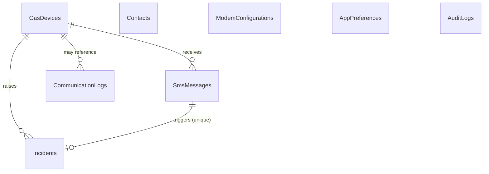

# Database and Schema Evolution

## Location and technology

- Engine: SQLite via `Microsoft.EntityFrameworkCore.Sqlite` 10.
- Path: `%LOCALAPPDATA%\GasGuardDesktop\gasguard.db`.
- Backups: `%LOCALAPPDATA%\GasGuardDesktop\backups`.
- Unprocessed SMS journal: `%LOCALAPPDATA%\GasGuardDesktop\inbox`.
- Journal mode: WAL is requested at startup; foreign keys are enabled on every connection and
  verified with `PRAGMA foreign_keys`.
- Default busy timeout: 10 seconds.
- All application timestamps are stored in UTC using a converter to normalise writes and mark reads
  as UTC. The UI and reports convert to `Africa/Lagos` (UTC+01:00).
- The database is local, single-user and contains no cloud credentials.

## Entity relationship overview



## Tables

### GasDevices

Detector registry. Idempotent deactivation is used; records are never hard-deleted.

Key fields: `Id` (GUID PK), `DeviceCode` (unique, 3–32 chars), `DisplayName`,
`InstallationLocation`, `ExpectedSenderNumber` (unique, +234 E.164), `DetectorType`,
`Description`, `InstallationDate`, `IsActive`, `LastSuccessfulCommunicationUtc`,
`LastReportedState`, `LastReading`, `LastReadingUnit`, `LastSequenceNumber`, `LastEventCode`,
`LastCommunicationErrorUtc`, `LastCommunicationError`, `MaintenanceNotes`, `IsDemo`,
`CreatedAtUtc`, `UpdatedAtUtc`.

Indexes: unique `DeviceCode`, unique `ExpectedSenderNumber`, `IsActive`,
`LastSuccessfulCommunicationUtc`.

### SmsMessages

Immutable raw evidence plus parse/processing state.

Key fields: `Id`, `SenderNumberRaw`, `SenderNumberNormalized`, `BodyRaw` (TEXT, preserved),
`Fingerprint` (SHA-256), `ReceivedAtUtc`, `StoredAtUtc`, `ModemStorageIndex`, `SourceReference`,
`IsSimulated`, `ProcessingStatus`, `ProcessingDetail`, optional `DeviceId`/`DeviceCode`,
`ProtocolVersion`, `EventCode`, `Severity`, `Reading`, `Unit`, `SequenceNumber`,
`DeviceTimestampUtc`, `DeviceTimestampTrusted`, `ProcessedAtUtc`.

Indexes: `Fingerprint`, `SourceReference`, `ReceivedAtUtc`, `ProcessingStatus`,
`SenderNumberNormalized`. FK `DeviceId` → GasDevices with `RESTRICT` and nullable.

Processing status values: Pending, Processed, Duplicate, Invalid, UnknownDevice,
UnauthorizedSender, OutOfOrder, Failed, SimulationRejected. `Failed` is for a database-write failure;
such a row is rolled back, so it normally exists only as a result value. `SimulationRejected` records a
simulated message sent to a non-DEMO detector and is never applied to detector state.

### Incidents

Operator-visible incident with preserved snapshots and lifecycle fields.

Key fields: `Id`, `DeviceId`, `TriggeringSmsMessageId`, `DeviceCodeSnapshot`,
`DeviceNameSnapshot`, `LocationSnapshot`, `Severity`, `Status`, `OccurredAtUtc`,
`OccurredTimeSource`, `ReceivedAtUtc`, `OpenedAtUtc`, `Reading`, `Unit`, `SequenceNumber`,
`DedupKey`, `IsSimulated`, `AcknowledgedAtUtc`, `AcknowledgedBy`, `AcknowledgementNotes`,
`ResolvedAtUtc`, `ResolvedBy`, `ResolutionNotes`.

Unique indexes: `DedupKey`, `TriggeringSmsMessageId`. Other indexes: status, severity, received,
occurred, device. FKs to device and triggering SMS use `RESTRICT`; the latter enforces one incident
per triggering SMS and preserves the raw source. `DedupKey` is time-bucketed and distinguishes
simulated from real messages; a resolved-repeat uses a unique occurrence suffix so sequence reuse
after a reset does not permanently suppress a new incident.

State transitions are `Open → Acknowledged → Resolved`. A resolution requires a prior
acknowledgement and non-empty notes. NORMAL telemetry never changes incident status.

### Contacts

`Id`, `FullName`, `PhoneNumber` (unique, normalized), `Role`, `IsActive`, notification preference
flags, `Notes`, `CreatedAtUtc`, `UpdatedAtUtc`. Deactivation replaces deletion.

### ModemConfigurations

Single row (`Id = 1`) with simulated/physical mode, port, baud, data bits, parity, stop bits,
handshake, command timeout, polling interval, auto-connect, auto-reconnect and
delete-after-persistence. No SIM PIN or credential is stored. A default simulated configuration is
seeded by the migration.

### CommunicationLogs

Operational history: timestamp, direction, kind, outcome, summary, detail, error code, recipient,
provider reference, simulated flag, optional device reference, modem storage index. Used for the
dashboard failure list, audit/reporting and outgoing SMS logs.

### AuditLogs

Timestamp, actor, action, entity type/id, outcome (`Success`, `Failure`, `Denied`) and non-sensitive
details. Covered actions include device/contact changes, modem configuration, incident
acknowledgement/resolution, exports, backups/restore, retention, demo actions, test SMS, and
security rejections. Credentials, SIM PINs, SMS bodies and SMS content are not recorded here.

### AppPreferences

Single row (`Id = 1`): stale threshold, retention days, automatic notification flag, max
notification attempts, minimum log level, last backup timestamp/path, updated timestamp. Seeded by
the migration.

## Transaction and constraint rules

- An incoming message, any incident, communication log and its audit entry are committed together.
- Incident creation is additionally checked against a 15-minute recent-incident duplicate window;
  the unique time-bucketed `DedupKey` and unique `TriggeringSmsMessageId` remain database guardrails.
- Acknowledgement/resolution audit rows are committed in the same transaction as the status change.
- Device, contact and settings changes add their audit rows to the same unit-of-work commit. External
  actions (sent SMS, file exports, backup files) use best-effort audit after the external effect.
- Foreign keys are enforced and checked in backup validation.
- Modem storage messages are deleted only after a committed `SmsMessage` (+ incident, when
  applicable).
- A duplicate message is prevented from causing a second incident by application logic and database
  uniqueness.
- Device deactivation is a field update; incidents and messages remain.
- Retention deletion never removes incidents, linked SMS trigger messages, or audit rows whose
  EntityType is `Incident`. It may remove old non-incident audit rows.

## Incoming SMS journal (outside the database)

The journal is an atomic JSON-file crash-recovery queue under `inbox\`. An entry contains the raw
incoming SMS and its source reference/storage index. The coordinator replays entries after startup and
removes a file only after the message has been persisted (and duplicate policy has resolved it).
Malformed/unreadable journal files are quarantined under `inbox\quarantine\` and logged rather than
silently deleted. The journal is not included in a SQLite backup; pending entries survive a database
restore and are retried on restart. It contains raw SMS data and relies on the user-profile ACL.

## Initial migration and schema evolution

Initial migration: `src/GasGuard.Infrastructure/Persistence/Migrations/*_InitialCreate.cs`.
It creates all tables, indexes, constraints, and seeds the default modem/preference rows.

At startup `StartupService`:

1. Ensures application folders exist.
2. Checks pending migrations for an existing database.
3. Creates a verified pre-migration backup if migrations are pending. Migrations are stopped if that
   backup cannot be verified.
4. Applies migrations.
5. Ensures WAL mode where possible, verifies foreign-key enforcement and repairs missing singleton
   settings rows.

To add a schema change during development:

```powershell
dotnet ef migrations add <MeaningfulName> `
  --project src/GasGuard.Infrastructure `
  --output-dir Persistence/Migrations
```

Do not hand-edit the live database. Do not squash history for a released database. Test the
migration against a copy of an existing database, then use the application startup path (which
creates the verified pre-migration backup) or a controlled deployment procedure. A migration that
drops a column or table containing safety evidence requires explicit review and a preservation plan.

## Backup and restore

- Backup uses the SQLite online backup API, then checkpoints/finalises the file and removes WAL
  sidecars so the `.db` is self-contained.
- Validation requires `PRAGMA integrity_check = ok`, required core tables and no
  `PRAGMA foreign_key_check` violations.
- Restore rejects the live database as its own source, validates the candidate first and creates a
  verified pre-restore safety backup. The running app pauses ingestion/reconciliation before replacing
  the database and validates the result. A failed validation attempts a rollback from the safety
  backup.
- Restore always requires an application restart. The current UI closes the application after a
  successful restore.
- Backups should still be copied to independent storage for real use; the local folder is not a
  disaster-recovery strategy.

## Practical integrity checks

```sql
PRAGMA integrity_check;
PRAGMA foreign_key_check;
PRAGMA foreign_keys;
SELECT COUNT(*) FROM Incidents WHERE DedupKey IS NULL OR DedupKey = '';
SELECT DeviceCode, COUNT(*) FROM GasDevices GROUP BY DeviceCode HAVING COUNT(*) > 1;
```

## Limitations

- SQLite is single-writer; the app uses short transactions and a busy timeout but is not a
  multi-user server database.
- Retention cleanup is manual; there is no background scheduler.
- Audit, SMS, journal and backup data are stored unencrypted in the user's local profile at the
  application layer. Protect the Windows account and machine with ACLs and device encryption.
- There is no in-app user authentication or role authorization; the Windows account is recorded as the
  audit actor.
