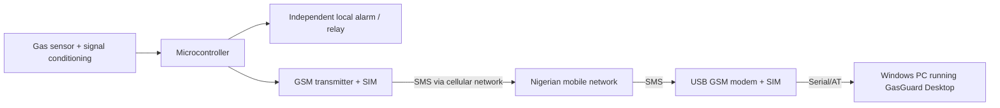

# Hardware Integration Guide

## Validation status — read first

**No physical USB GSM modem, SIM, detector or GSM network was available in the development
environment. No physical hardware test result is claimed.**

The implementation and simulator have been exercised. The physical adapter has automated tests
using a scripted serial transport. Real command support varies by modem firmware, USB driver, SIM
provisioning and mobile network. The detailed evidence checklist is
[GSM_HARDWARE_VALIDATION.md](GSM_HARDWARE_VALIDATION.md). SMS security limits are in
[SMS_SECURITY_AND_PROTOCOL.md](SMS_SECURITY_AND_PROTOCOL.md). Follow the validation checklist in this guide on the actual target
hardware before making any compatibility statement.

## Intended physical topology



### Non-negotiable safety boundary

- The local detector alarm must be implemented in hardware and must remain functional if the PC,
  Windows, USB cable, SQLite, modem, SMS network or this application is unavailable.
- GasGuard Desktop is a monitoring and incident-recording system. It is not the alarm controller.
- Do not use the desktop application to energise/de-energise a gas valve, fan or alarm without a
  separately approved safety design, rated hardware and independent local interlocks.
- Do not test with uncontrolled gas or naked flames. Use manufacturer-approved calibration gas and
  qualified personnel with appropriate ventilation and PPE.

## Local alarm independent verification (hardware scope, not performed here)

This test must be performed by qualified hardware personnel using the detector manufacturer's
approved self-test/bump-test procedure. Never use uncontrolled gas or a naked flame.

1. Disconnect the Windows PC and USB GSM modem completely.
2. Confirm the detector still has its independent power source and the local alarm path is healthy.
3. Trigger the detector's approved self-test or a manufacturer-approved calibration gas response.
4. Verify the local audible alarm, visual indicator and any independent relay/annunciation operate.
5. Repeat with the PC running but GasGuard Desktop closed, and with the GSM network/SIM unavailable.
6. Record the detector model, firmware, power source, alarm thresholds, test method, measured result,
   date and operator.
7. Confirm in the design documentation that the local alarm is not dependent on any serial, SMS,
   SQLite, Windows or GasGuard Desktop component.

Expected evidence for an acceptable design: local alarm operates with the PC and all networks off.
This project did not have detector hardware, so this test remains **NOT PERFORMED** and no claim of
independent alarm verification is made.

## Recommended modem characteristics

There is no single guaranteed USB GSM modem model for this project. Look for:

- a USB modem that exposes a **serial COM port** and supports 3GPP AT commands;
- SMS **text mode** (`AT+CMGF=1`);
- SIM storage and `AT+CMGL` unread-message listing;
- network registration and SIM status commands;
- a stable Windows 10/11 USB serial driver;
- support for the bands used by the chosen Nigerian network.

SIM800/SIM7600-class modules are common in student projects, but do not assume command support or
network compatibility. Check the exact module's AT command manual and test it. Avoid modem dongles
that expose only a proprietary network interface and no usable AT serial port.

## SIM preparation

1. Obtain a SIM on the chosen Nigerian network (for example MTN, Airtel, Glo or 9mobile) with SMS
   service enabled and sufficient airtime/plan.
2. Verify SMS works in a normal phone before using it in the modem.
3. Record the SIM's own number. This is the detector/transmitter expected sender value that must be
   entered in the GasGuard detector registry.
4. **SIM PIN handling:** GasGuard does not ask for or store a SIM PIN. Disable the SIM PIN through a
   phone (or unlock it through an approved procedure) before installing it in the modem. If the app
   reports `SIM PIN required`, it will display the state but cannot unlock the SIM.
5. Set the SMS service centre if the network requires it. GasGuard does not implement a manual SMSC
   setting; normally the SIM supplies it.
6. Label the SIM and keep it in a controlled location.

Do not put SIM PINs, credentials or network secrets in source code, logs or screenshots.

## COM port identification

1. Plug the modem into the PC.
2. Open **GSM Modem → Refresh COM ports**.
3. Start with the port named by the modem driver. If several ports appear, consult Device Manager.
   Some modems expose multiple ports (AT, diagnostics, modem). Use the documented AT port.
4. Enter the port manually if it does not appear in the detected list.
5. Close any other program (vendor dashboard, terminal tool) that has the COM port open.

Windows serial support is through `System.IO.Ports`. A USB driver may need to be installed by an
administrator.

## Serial settings

| Setting | Default | Notes |
|---|---|---|
| Baud rate | 115200 | Some modules auto-baud; try 9600/19200/38400/57600/115200 per documentation. |
| Data bits | 8 | Must match the modem. |
| Parity | None | Most USB modems use none. |
| Stop bits | One | Most USB modems use one. |
| Handshake | None | Use hardware/software flow control only if the modem requires it. |
| AT timeout | 8000 ms | Increase for slow networks/modems. |
| Poll interval | 30 s | Unread SMS is polled; new-message indications request earlier reconciliation. |
| Delete after persistence | On | This is the safe default. |

Settings are saved locally in SQLite. They are not secrets.

## Implemented AT workflow

Connection sequence (best-effort commands may fail without aborting the serial session):

```text
ATE0
AT
ATI
AT+CPIN?
AT+CSQ
AT+CREG?
AT+COPS?
AT+CMGF=1
AT+CSCS="GSM"      (fallback: AT+CSCS="IRA")
AT+CNMI=2,1,0,0,0
```

Read unread stored messages:

```text
AT+CMGL="REC UNREAD"
```

Send a confirmed test/automatic message (single segment, printable ASCII):

```text
AT+CMGS="+2348031234567"
> <message body><Ctrl-Z>
```

Delete a stored message only after successful database persistence:

```text
AT+CMGD=<storage index>
```

The application expects text mode. It does not parse PDU mode, does not reassemble multipart SMS,
does not implement UCS2 and does not request delivery reports. A modem that only supports PDU mode
will not be compatible until those features are added.

## Connection health interpretation

- **Connected** means the serial port is open. It does not mean the SIM is ready or the network is
  registered.
- **Modem ready** requires serial connected + SIM `READY` + network registered (home or roaming).
- Signal quality uses `AT+CSQ` 0–31 (99 shown as unknown).
- `AT+CNMI` failure does not stop polling; the app falls back to periodic unread polling.
- The dashboard's detector state is derived from detector reports and freshness, never from modem
  connectivity.

## Polling, notifications and deletion

1. A `+CMTI` notification triggers an immediate reconciliation request.
2. The coordinator asks the modem for unread stored SMS.
3. Each message is journaled under `%LOCALAPPDATA%\GasGuardDesktop\inbox` before processing; the
   journal is replayed after restart and removed only after committed persistence.
4. Each message is persisted with its raw body; source-reference/fingerprint checks make replay
   idempotent.
5. Only after a committed result is the storage index deleted (when the setting is on).
6. If persistence fails, the message is not deleted. It remains available for reconciliation, and the
   journal entry remains.
7. If deletion fails after persistence, the failure is logged; on a later poll the
   message is deduplicated rather than producing a second incident.
8. Direct `+CMT` delivery is also journaled, but a very small receive-to-journal window remains; modem
   storage retention covers messages received while disconnected.
7. Duplicate and out-of-order messages are retained for review but do not create duplicate
   incidents.

## Outgoing SMS limits

- The UI sends test SMS only after operator confirmation.
- Automatic contact notifications are off by default. When enabled they use 1–3 attempts per
  contact.
- A successful result means the modem accepted the message (`OK` / `+CMGS` reference). It is **not**
  a network acknowledgement or recipient delivery confirmation. The application never labels a
  message as "delivered".
- Message bodies are limited to 160 printable ASCII characters in physical text mode. The parser
  rejects embedded control characters, non-ASCII content, PDU/multipart/UCS2 input; none of those
  modes is implemented. A non-ASCII byte warning in the serial transport indicates lossy text-mode
  decoding and must be investigated.
- Do not use SMS for safety-critical control. A failed/slow SMS does not replace the local alarm.

## Nigerian network validation checklist

Perform this with the actual modem, SIM and network, without gas:

| Check | Procedure | Expected evidence | Result |
|---|---|---|---|
| Driver/COM | Device Manager and `Refresh COM ports` | AT port appears and opens | NOT PERFORMED |
| AT identity | Connect | ATI/model visible | NOT PERFORMED |
| SIM ready | Insert prepared SIM and connect | `SIM ready` | NOT PERFORMED |
| Network registration | Connect/refresh | Registered home/roaming and operator | NOT PERFORMED |
| Signal | Connect/refresh | Valid 0–31 quality | NOT PERFORMED |
| Text mode | Connect | SMS text mode enabled | NOT PERFORMED |
| Incoming SMS | Send a known test SMS from the registered sender SIM to the modem SIM | Raw message persisted once | NOT PERFORMED |
| Deduplication | Re-send identical message | No duplicate incident | NOT PERFORMED |
| Persistence retention | Simulate DB failure or stop DB write, send SMS | SMS remains unread; later reconciliation recovers or rejects it | NOT PERFORMED |
| Outgoing test SMS | Confirm a test message to a controlled phone | Phone receives test SMS; app claims submission only | NOT PERFORMED |
| Deletion | Inspect modem storage after successful processing | Message deleted only after commit | NOT PERFORMED |
| Disconnection | Unplug modem while connected | Fault visible; no false detector-online claim; reconnect works | NOT PERFORMED |
| Failure status honesty | Force a required status command failure | Modem remains faulted; refresh does not overwrite with Connected | NOT PERFORMED |
| Simulation isolation | Try simulator injection against a non-DEMO detector | Rejected, retained/audited; detector state unchanged | NOT PERFORMED |
| Restart | Close/restart application | Incidents retained; no duplicate creation | NOT PERFORMED |
| Network changes | Test on the intended Nigerian operator/SIM profile | Document actual results | NOT PERFORMED |

Record the modem model, firmware, SIM operator, firmware AT command manual version, test date and
measured results. Do not copy these as "passed" unless the evidence exists.

## Troubleshooting

| Symptom | Checks |
|---|---|
| Port not listed | Driver installed; cable; Device Manager; close other serial applications; try another USB port. |
| AT times out | Correct AT port; baud; cable; modem not in a proprietary mode; restart modem. |
| `SIM PIN required` | Unlock/disable SIM PIN in a phone; GasGuard does not store or enter PINs. |
| SIM not inserted | Reseat SIM; check SIM slot orientation; try the SIM in a phone. |
| Not registered / searching | Antenna, signal location, SIM activation/airtime, operator coverage, modem band support. |
| SMS text mode failure | Check modem manual for `AT+CMGF`; some modules require a different character set or are PDU-only. |
| No incoming SMS | Test SMS from a phone; network SMS service; notification/polling; modem storage full; sender number correctness. |
| Message read but invalid | Compare exact body to [SMS protocol](SMS_PROTOCOL.md); check ASCII/single-line delivery; provider may alter text. |
| Duplicate incidents | Check sequence numbers; ensure firmware increments `seq`; review device clone/spoof possibility. |
| Test SMS rejected | SIM/network readiness, recipient format, 160-character limit, printable ASCII, modem error code. |
| Message remains in storage | Persistence/DB failure; check database health and communication logs; reconcile manually. |
| Application claims modem ready but no SMS | Readiness is serial + SIM + registration, not proof that SMS routing or detector traffic works. |

## Security and data handling

- A modem can receive SMS from any sender. GasGuard validates the sender against the registry but
  SMS identity is not cryptographically secure.
- Do not configure the detector transmitter to send executable commands. GasGuard does not execute
  SMS content.
- No SIM PIN, APN password or authentication secret is stored by the app.
- Backups and logs may contain operational details; protect the Windows profile and any exported
  files.
- A production deployment should add payload authentication, secure storage of per-device keys,
  Windows account controls and an independent alarm-monitoring path.

## Physical hardware conclusion

Until the checklist is completed on the intended modem/SIM/network, treat physical GSM support as
**implemented but unvalidated**. The simulator is the verified demonstration path.
